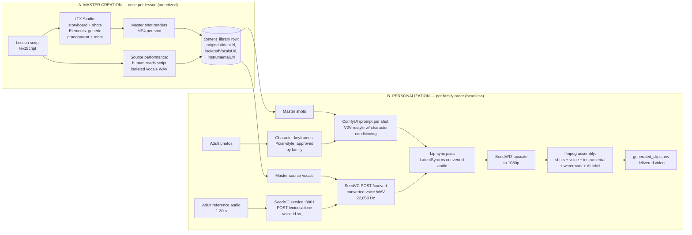

# VoxTree — Video Pipeline Blueprint: LTX Studio + ComfyUI + SeedVC

**Built:** Mon Nov 2, 2026. **Status:** Planning blueprint — LOCAL DOCUMENT ONLY. Nothing built, pushed, or rendered yet. Real inference of every model named here is still unproven in this pipeline; the Week 3 demo (Nov 13–19) is the first true test.
**Serves:** Pilot launch Sat Nov 28, 2026 — $29.99/month, $500 budget ($250 rendering/GPU credit line), ~$2/video operating target.
**Locked output (Oct 29, do not re-litigate):** Pixar-style visual clone of the adult, present in a chair reading for the WHOLE video; voice = their real cloned voice (SeedVC conversion). Lessons for ages 2–8, ~2 minutes.

**Relationship to repo docs:** This blueprint **supersedes** `docs/METAHUMAN_PIPELINE.md` for the pilot (that doc's Unreal/MetaHuman photoreal path is parked — it contradicts the locked Pixar-style default) and supersedes the Blender worker in `workers/avatar_pipeline/` as the pilot rendering path (kept in repo, not used by this pipeline). It aligns with `docs/CURRENT_STATE.md` on voice (SeedVC only) and consent.

---

## 1. Architecture at a glance

**The one design rule that makes the math and the trust model work:** LTX Studio (cloud, manual, subscription) touches *masters only* — generic performances, no real family's data. Everything containing a real adult's face or voice runs in ComfyUI + the SeedVC service on GPU we control (rented pod now, local RTX 5090 later). That keeps the "we clone you, never your child / voice not for sale / delete anytime" promises mechanically true: revocation deletes the SeedVC reference (`DELETE /voices/{id}`), the character keyframes, and the family LoRA if one exists — there is no third-party cloud holding a copy.

### Stage table

| # | Stage | Tool | Inputs → Outputs | Runs where | Per-master or per-family | Est. time | Est. cost |
|---|---|---|---|---|---|---|---|
| A1 | Lesson script + shot list | Human + LTX Studio storyboard | Script text → `textScript` + shot list | LTX Studio cloud (manual) | Per-master | 30–60 min human | in subscription |
| A2 | Master shots | LTX Studio (LTX-2.x models + Elements) | Shot prompts + generic-grandparent Element → MP4 shots, 720p, 24 fps | LTX Studio cloud | Per-master | ~400 credits/lesson (see §7) | in subscription |
| A3 | Source performance | Human reader (master actor / founder) | Script → isolated vocals WAV (quiet room, phone/usb mic) + instrumental track | Studio/home | Per-master | 15–30 min human | $0 |
| A4 | Content row | VoxTree app | Shots assembled to master MP4 → `content_library`: `originalVideoUrl` (master), `isolatedVocalsUrl` (source vocals), `instrumentalUrl` (music bed), `contentMode='tts'`, `textScript` | VPS | Per-master | minutes | $0 |
| B1 | Voice registration | SeedVC service (repo `workers/seedvc`) | Adult reference audio (1–30 s) → `POST /voices/clone` → voice id `sv_<uuid>` stored as `family_voices.provider_voice_id` | GPU box (same pod/5090) | Per-family (once) | seconds | ~$0 |
| B2 | Character keyframes | ComfyUI stills graph (base img model + PuLID assist, §5) | Adult photos → 3 approved keyframes (wide/medium/close framing of THE character, Pixar-style) PNG | GPU box | Per-family (once, reused all lessons) | ~5 min GPU + human/family approval | ~$0.10 GPU |
| B3 | Voice conversion | SeedVC service | Source vocals (A3) + voice id → `POST /convert` (multipart: `voice_id`, `source` WAV; defaults diffusion_steps 25, cfg 0.7) → converted WAV, **22,050 Hz mono 16-bit** | GPU box | Per-family per lesson | ~1 min (est., §6) | ~$0.03 GPU |
| B4 | Shot personalization | ComfyUI graph §5 (LTX V2V/IC-LoRA primary; I2V fallback) | Master shot MP4 + character keyframe → personalized shot MP4 720p 24 fps, silent | GPU box | Per-family per lesson | 25–40 min GPU (14 shots) | see §7 |
| B5 | Lip-sync | ComfyUI LatentSync nodes | Personalized shots + converted WAV (resampled 16 kHz for the sync model) → mouth-corrected shots | GPU box | Per-family per lesson | 8–15 min GPU | see §7 |
| B6 | Upscale | ComfyUI SeedVR2 3B | 720p shots → 1080p shots | GPU box | Per-family per lesson | 5–10 min GPU | see §7 |
| B7 | Assembly + label | ffmpeg (pattern already in `app/api/clips/generate`) + `lib/watermark` | Shots + converted voice + instrumental → final MP4 (1080p, AAC 48 kHz) with audio watermark payload embedded (`lib/watermark.ts`) and **visual "Made with AI + family permission" label** burned in (new — repo watermark is audio-only today) | VPS CPU / GPU box CPU | Per-family per lesson | 1–3 min CPU | ~$0 |
| B8 | Delivery | VoxTree app | Final MP4 → `generated_clips` row, served via authenticated `/uploads` | VPS | Per-family | — | $0 |

**Format contracts (fixed, do not improvise):**
- Master shots and personalized shots: MP4 (H.264), 720p generation → 1080p delivery, 24 fps, shot lengths 4–10 s, frame counts 8n+1 (LTX latent rule: 97/121/193 frames typical).
- Source vocals: WAV, any clean recording; stored per content row as `isolatedVocalsUrl`. This exact file is the SeedVC source — the repo's clips route already fetches `isolatedVocalsUrl` as the conversion source in `contentMode='tts'` (the mode name is legacy; semantically it now means *source-vocal conversion mode*).
- SeedVC output: WAV 22,050 Hz mono (speech model; 44,100 Hz only in F0/singing mode, unused here). Resample to 48 kHz at assembly; LatentSync consumes a 16 kHz copy.
- SeedVC service contract (from `lib/seedvc.ts` + `workers/seedvc/server.py`, PR #47): base URL `SEEDVC_SERVICE_URL` (default `http://localhost:8001`); `POST /voices/clone` multipart (`name`, `file`) → `{voice_id: "sv_..."}`; `POST /convert` multipart (`voice_id`, `source`, optional `diffusion_steps`, `length_adjust`, `inference_cfg_rate`, `f0_condition`, `auto_f0_adjust`, `pitch_shift`) → WAV bytes; `DELETE /voices/{id}` (404 = already gone = success); `GET /health`. Voice-job queue payloads carry `sourceAudioBase64` or `sourceAudioUrl`; a payload without source audio fails permanently with `seedvc_requires_source_audio` — the blueprint's orchestration must always populate one of those from `isolatedVocalsUrl`.

---

## 2. Flow A — Master creation (once per lesson, LTX Studio-led)

1. **Write the lesson script** (VoxTree-authored, ages 2–8, ~280–320 spoken words ≈ 2 min). Store as the content row's `textScript`. Mark sentence boundaries — they become shot boundaries (§4).
2. **Storyboard in LTX Studio.** Script → scenes/shots in the Studio storyboard; create two **Elements** (Lightricks' reusable character/prop/location system): (a) the *generic master grandparent* (warm, neutral, deliberately NOT resembling any customer), (b) the *reading room* set. Lock the style preset to the Pixar-like look. Camera per shot from the §4 pattern. Commercial use requires **Standard plan or higher** — Free/Lite are personal-use only (verified on ltx.io pricing + help center, §8).
3. **Generate shots, pick takes.** Budget ~3 attempts per shot in Studio credits; export shots at 720p. Studio is the previs + master renderer; do not attempt per-family work here.
4. **Record the source performance.** One human reads the exact script, alone in a quiet room, at a natural storyteller pace. This recording is load-bearing twice: SeedVC converts *it* (prosody/timing are inherited), and the master video's mouth motion was performed to the same script. Record vocals isolated (no music) → `isolatedVocalsUrl`. Source the instrumental bed separately (licensed/royalty-free, consistent across the series) → `instrumentalUrl`.
5. **Assemble the master** (ffmpeg concat of shots + source vocals + instrumental at low bed level) → `originalVideoUrl`. Create the `content_library` row (`contentMode='tts'`). The master is also the internal QA reference: if the master isn't charming with a generic grandparent, personalization won't save it.

*Alternative master path (keep in back pocket):* the same storyboard executed in ComfyUI with LTX models directly (no Studio). Cheaper at scale, loses Studio's Elements/storyboard ergonomics. Decide after the demo measures how painful Studio exports are — Goding's call (§9).

## 3. Flow B — Personalization (per family order, headless)

Orchestrated by the VoxTree app + voice-job queue that already exist; ComfyUI is driven through its HTTP API — **POST the API-format workflow JSON to `/prompt` on the ComfyUI server (default :8188), poll `/history/{prompt_id}` or the `/ws` socket, fetch outputs via `/view`** — no UI, no clicking, identical on a rented pod and on the 5090 laptop.

1. **Consent + capture (already built):** adult self-consents (18+ attestation), uploads photos + a voice reference. Reference target: **10–30 s of clean speech** (Seed-VC accepts 1–30 s; longer-in-range = better similarity; our capture script should ask for ~20–30 s, not the minimum).
2. **Register voice:** app calls SeedVC `POST /voices/clone` → `sv_...` id (B1). One-time per family.
3. **Build character keyframes (B2)** and get family approval of the *character* before any video renders — cheapest rejection point in the whole pipeline. Keyframes are reused across every lesson that family orders (amortized).
4. **Convert the voice (B3):** enqueue `clip_generate` with `sourceAudioUrl = content.isolatedVocalsUrl` (+ `providerVoiceId`/`voiceId`) — exactly the payload shape `lib/voice-worker.ts` consumes today. Output WAV lands at `data/uploads/voice-jobs/<jobId>.wav`.
5. **Personalize shots (B4):** one ComfyUI `/prompt` submission per master shot (§5 graph), substituting: master shot file, family's keyframe(s), shot seed (fixed per lesson for reproducibility).
6. **Lip-sync (B5)** against the converted audio, **upscale (B6)**, **assemble (B7)** with the converted voice as the lead track, instrumental bed under it, audio watermark embedded, visual AI label burned in.
7. **Deliver (B8)** + log real per-stage GPU seconds to `lib/cost-tracking` — the demo and pilot must produce actual cost data, not this doc's estimates.

Ordering note: run B3 (audio) *before* B4/B5 — the converted audio is an input to lip-sync, and if conversion fails or sounds wrong, no video GPU time is spent.

## 4. Shot structure — how "in the chair the whole time" survives 5–10 s generations

LTX generations are short (LTX-2-class clips up to ~10 s per generation; LTX-Video 0.9.8 distilled advertises up to 60 s but quality/consistency over long spans is unverified — plan on ≤10 s). A 2-minute video is therefore **~14 shots**, and the script is written as 14 beats from the start:

| Shot type | Count in 2 min | Length | What it carries |
|---|---|---|---|
| Medium — character in chair, reading (hero shot) | 5 | 8–10 s | Most narration; the "she's really there" feeling |
| Close — face, key lines / reactions | 3 | 5–8 s | Emotional peaks, greetings, the moral |
| Wide — chair + room establishing | 1–2 | 6–8 s | Open + close of the video; resets the scene |
| Cutaway — book page turning / page illustration | 2 | 4–6 s | **No face** — hides edit points, zero drift risk |
| Cutaway — lesson visual (letter, number, object) | 2 | 5–8 s | The teaching content itself |

Rules that preserve the locked style and consistency:
- **Audio is continuous; video conforms to audio, never the reverse.** One SeedVC conversion of the full source reading is the master clock. Shots are cut on sentence boundaries (timestamps from aligning `textScript` to the source audio). The character is *in the chair in every face shot* — cutaways are the only face-free moments (~30% of runtime), which reads as normal editing, not absence.
- **Identity is anchored by keyframes, not prompts.** Every face shot is conditioned on the family's approved keyframes (§5). Same seed family + same keyframe + same style string per lesson. Prompts alone drift — that failure mode is designed out.
- **Performance comes from the master.** The primary personalization path (§5) is video-to-video from the master shot, so head motion, gestures, page turns, and mouth timing are the master's performance — identical structure for every family, which is exactly the master-video model.
- Page-turn cutaways are placed at every chapter/section break in the script; they are the cheapest place to absorb a re-roll (regenerate a face shot without breaking continuity).

---

## 5. ComfyUI personalization workflow — node-level spec

Two graphs: **G1 Stills** (character keyframes, per family once) and **G2 Shot** (per shot per order). Node names are ComfyUI core / ComfyUI-LTXVideo (Lightricks' official custom-node pack; LTX-2 support is also in ComfyUI core) unless marked *(custom pack)*. This spec is the deliverable — a workflow JSON can only be honestly produced by exporting from a live ComfyUI once these nodes are wired and version-pinned, so **no JSON is included** (an invented JSON would load broken).

### G1 — Character keyframes (stills)

| Step | Node(s) | Inputs → Outputs | Notes |
|---|---|---|---|
| 1 | `LoadImage` ×2–4 | Adult photos → IMAGE | Consented photos only |
| 2 | PuLID Flux node *(custom pack: PuLID_ComfyUI)* | Photos → identity conditioning | Assist only — see ranking in §6; its job is likeness nudging inside a stylized generation, not photoreal pasting |
| 3 | `CheckpointLoaderSimple` (Flux/SDXL-class stills model — pin at build time) + `CLIPTextEncode` ×2 | Style prompt ("storybook 3D animation still, [character description], sitting in a reading chair, warm library") → CONDITIONING | One locked style string for the whole product |
| 4 | `KSampler` (fixed seed per family) | → keyframe candidates (768×768+) | Generate ≥6, human selects |
| 5 | `SaveImage` | → `keyframe_medium.png`, `keyframe_close.png`, `keyframe_wide.png` | Family approval gate after this graph |

### G2 — Shot personalization (primary path: V2V restyle; fallback: I2V + lip-sync)

| Step | Node(s) | Inputs → Outputs | Notes |
|---|---|---|---|
| 1 | `VHS_LoadVideo` *(custom pack: VideoHelperSuite)* | Master shot MP4 → IMAGE batch (24 fps) + frame count | One graph run per shot |
| 2 | `LoadImage` | Family keyframe for this shot type → IMAGE | Medium/close/wide matched to master shot type |
| 3 | LTX IC-LoRA control extraction (depth + pose + edges) — ComfyUI-LTXVideo example: *IC-LoRA distilled (depth + human pose + edges)* | Master frames → control conditioning | Carries the master's performance/camera into the render |
| 4 | `CheckpointLoaderSimple` / LTX loader (`ltx-2-19b-distilled-fp8` on 32 GB+; `ltxv-13b-0.9.8-distilled` GGUF on 24 GB — §6) + `LTXAVTextEncoderLoader` (Gemma) | → MODEL/CLIP | Distilled = 8 steps, CFG 1 |
| 5 | `LTXVImgToVideo`-family conditioning / V2V conditioning with keyframe as identity reference + master control | Prompt = locked style string + shot action line → CONDITIONING | Identity enters here, from the approved keyframe |
| 6 | `KSampler` (distilled settings, seed fixed per lesson+shot) | → LATENT video (720p, 8n+1 frames) | Per-shot re-roll budget: 1 |
| 7 | `VAEDecode` (+ tiled decode on low VRAM) | → personalized shot frames (silent) | |
| 8 | LatentSync nodes *(custom pack: ComfyUI-LatentSync, v1.6)* | Shot frames + converted audio slice for this shot (16 kHz) → mouth-corrected frames | **Primary-path discount:** because mouth timing already matches (same source performance), run at conservative strength; if the demo shows V2V mouth is already acceptable, this stage becomes close-shots-only — the single biggest cost lever (§7). Fallback I2V path: this stage is mandatory on every face shot. Wav2Lip is **excluded** — its README prohibits commercial use. |
| 9 | SeedVR2 nodes *(custom pack: ComfyUI-SeedVR2_VideoUpscaler, 3B fp8)* | 720p frames → 1080p frames | Temporal-aware; per-frame ESRGAN flickers — do not substitute |
| 10 | `VHS_VideoCombine` | → shot MP4 (1080p, 24 fps, silent) | Assembly adds audio later, once, in ffmpeg |

**Orchestration contract:** the app submits G2 once per shot via `POST /prompt` (API-format JSON with node inputs substituted per shot/family), tracks `prompt_id`s, and treats ComfyUI like the SeedVC service — a local GPU service behind HTTP, replaceable host (pod IP today, localhost on the 5090 later), zero customer data anywhere else.

## 6. Component findings (researched Nov 2, 2026 — sources §11)

**LTX in ComfyUI.** LTX-2 (19B, audio+video) is built into ComfyUI core; Lightricks' ComfyUI-LTXVideo pack adds the advanced nodes/workflows (IC-LoRA control, two-stage upscale, V2V detailer). LTX-2.3 (22B, Mar 2026) and LTX-2.5 (open weights, Aug 2026) are the current line. Practical VRAM: LTX-2 fp8/distilled runs at 720p on 24 GB with offloading (RunPod guide); the full LTX-2.3 fp8 path wants **32 GB+** (ComfyUI-LTXVideo README prerequisite; distilled-fp8 total peak ~30 GB with the Gemma text encoder). The older LTXV 0.9.8 13B distilled GGUF is the low-VRAM fallback (community workflows peak ~7–14 GB at 1024px/161 frames). **Consequence: the RTX 5090 laptop (32 GB) is the first local card that runs the current model properly; the demo pod should be 48 GB+ or A100-80 class to remove VRAM as a variable.**

**Character consistency — ranked for a STYLIZED character:**
1. **Approved-keyframe conditioning (primary, §5):** identity is baked into 3 family-approved keyframes; video stages condition on them. No face-embedding model in the loop, so no photoreal pull. Cheapest and most controllable.
2. **Per-user LoRA (quality ceiling, later):** the repo already has a `lora_train` job concept (runs via Replicate routes today). A character LoRA is the strongest identity lock known, but it's a per-family training job (time + cost on the *first* video only, reused after). Defer until demo data shows keyframes aren't enough.
3. **PuLID (assist in G1 only):** best style-flexibility of the face-ID family, explicitly resists washing out a stylized look — but it is still an InsightFace-embedding method benchmarked on real faces; expect likeness help, not miracles, on Pixar-style faces.
4. **InstantID / IP-Adapter FaceID (not recommended here):** highest photoreal similarity (InstantID) but pose-locked and realism-biased; FaceID reads "soft/cousin-like." Wrong tool for a stylized character.

**Lip-sync.** LatentSync (ByteDance): v1.5 = 8 GB VRAM / 256px face, v1.6 = ~18 GB / 512px face, ~6 fps processing on a 4090-class card (single secondary source — treat as estimate). License: code Apache-2.0 (cleanest of the field; one license audit notes the weights carry an OpenRAIL++ tag with no license text — flag for legal review, don't treat as settled). MuseTalk 1.5: MIT code, ~30 fps on V100-class, 4–8 GB — faster, but a dependency (face parser trained on CelebAMask-HQ) has non-commercial-research terms in one audit — also a legal-review flag. **Both were trained on real human faces; performance on Pixar-style faces is UNVERIFIED — a named demo test.** Structural advantage stands regardless: SeedVC output and master mouth motion share the source performance's timing, so lip-sync here is *correction*, not generation from scratch.

**Seed-VC (from the official repo + the verified wrapper in `workers/seedvc`):** zero-shot from a **1–30 s reference**; model used by our service is the offline speech model (Whisper-small content encoder, 22,050 Hz out); service defaults **diffusion_steps 25, inference_cfg_rate 0.7** (real-time mode uses 4–10 steps on the tiny model; offline RTF for the 98M speech model is **not published — UNVERIFIED**, demo must measure it). License: **GPL-3.0** (verified from the repo LICENSE in the PR #47 work; repo is archived) — see §9 risks.

**Finishing.** Upscale: SeedVR2 (one-step diffusion, temporal-aware, Apache-2.0 code+weights, ComfyUI pack by numz; 3B fp8 fits the 5090) is the current standard choice; FlashVSR is the faster watch-list alternative. Assembly: ffmpeg as the repo already does. Watermark: repo's `lib/watermark` embeds an audio payload (clipId/userId) — kept; the *visual* AI label is an ffmpeg overlay added at B7 (new work, small).

---

## 7. Cost model — per finished 2-minute family video

All times are **estimates to be replaced by demo measurements** (§9). GPU rates verified Nov 2: RunPod RTX 4090 Secure **$0.89/hr** (Community $0.34), A100 80GB Secure **$1.79/hr**, per-second billing.

**GPU minutes per family video (subsequent lessons; keyframes/voice already exist):**

| Stage | GPU min (est.) |
|---|---|
| B3 SeedVC conversion (2 min audio, 25 steps) | ~1 |
| B4 Shot personalization (14 shots, distilled, incl. load overhead) | 25–40 |
| B5 LatentSync 1.6 (~6 fps over 3,000 frames, face shots only ≈ 70% runtime) | 6–12 |
| B6 SeedVR2 3B upscale to 1080p | 5–10 |
| **Total** | **~40–65 min** (×1.3 re-roll factor → **52–85 min**) |

| Scenario | Math | Per-video cost | vs $2 target |
|---|---|---|---|
| Rented A100 80GB (demo config) | 52–85 min × $1.79/hr | **$1.55–$2.54** | ⚠️ Straddles the line |
| Rented RTX 4090 Secure (LTXV 0.9.8 distilled path) | 52–85 min × $0.89/hr | **$0.77–$1.26** | ✅ |
| Rented RTX 4090 Community | 52–85 min × $0.34/hr | $0.29–$0.48 | ✅ (availability/SLA weaker) |
| Local RTX 5090 — marginal (electricity only) | ~1 hr × ~0.5 kW ≈ 0.5 kWh × ~$0.17/kWh | **~$0.10** | ✅✅ |
| Local RTX 5090 — fully loaded | $4,000 laptop ÷ render-hours: at 1,000 hrs = $4.00/hr; at 4,000 hrs = $1.00/hr + electricity | $1.10–$4.10/hr of rendering | Volume decides |
| LTX-API fallback for B4 only (if self-host fails) | LTX-2.5 Fast 720p $0.09/s × 120 s × 1.3 re-rolls | **~$14/video** | ❌ Dead on arrival — reference only |
| First video per family (adds B2 keyframes ~5 min + approval loop; LoRA if ever adopted adds a training job) | + ~$0.15 GPU (keyframes) | +$0.15–0.30 | ✅ (LoRA cost UNVERIFIED — measure before adopting) |

**Master cost (amortized, not per family):** LTX Studio Standard $35/mo (28,000 credits ≈ computing seconds; a lesson ≈ 15 shots × ~9 s × ~3 attempts ≈ ~400 credits + storyboard iterations) — i.e., the subscription covers far more lessons/month than the pilot will author; plus ~45 min human time per lesson (storyboard + source recording). Over a 50-family pilot, master cost per delivered video is cents.

**Where the model breaks — say it plainly:**
1. **A100 + slow stages + re-rolls >1.3× breaks $2.** The demo config is for *learning*, not for unit economics; production economics need the 4090-class distilled path or the local 5090.
2. **If LatentSync is needed at full strength on every frame** (I2V fallback path), add ~5 min and a quality risk on stylized faces.
3. **Pod idle time bills.** Model downloads (~60 GB for LTX-2.3-class stacks) and setup are one-time per pod, but a pod left running between orders eats the margin — orchestration must stop/pause pods or batch orders.
4. **The $2 target survives only because masters are amortized.** Any design that regenerates the *lesson* per family (instead of restyling it) multiplies B4 by the full generation cost and breaks instantly — same lesson the earlier HeyGen/Hedra pricing research taught.

## 8. LTX Studio vs LTX API — the distinction that matters

- **LTX Studio** is a web product: script → storyboard → shots, **Elements** for reusable characters/props/locations, camera/lighting controls, shot retakes, timeline editor. Subscription (verified on ltx.io, Nov 2): Free $0 (800 one-time credits, **personal use only**), Lite $15/mo (8,000 credits, **no commercial license**), **Standard $35/mo (28,000 credits, commercial license, Elements)**, Pro $125/mo (110,000 credits). Credits replaced "computing seconds" as the meter. **No public API for the Studio itself was found** — you cannot drive the storyboard/Elements layer from code; it's a human's tool. (Flagged as *not found*, not *proven absent*.)
- **LTX API** is a separate Lightricks product (docs at docs.ltx.io) exposing the *models* (currently LTX-2.5): per-second pricing verified on ltx.io — Fast 720p **$0.09/s**, 1080p $0.13/s; Pro 720p $0.12/s, 1080p $0.17/s. fal.ai lists LTX-2.3 tiers around $0.04–0.08/s (single secondary source). These APIs could render *shots*, but at ~$11–14 per finished 2-min video they fail the $2 target by ~6× — they are a fallback for one-off hero shots, never the pipeline.
- **Open weights** (LTX-2/2.3/2.5 in ComfyUI) are the pipeline path. License terms are reported inconsistently across sources (some say Apache-2.0; the more careful sources say an **LTX-2 Community License, free commercially under $10M annual revenue**) — treat as **UNVERIFIED until read in the model repo at build time** (§9).

## 9. Week 3 demo plan — Nov 13–19, 5 test videos, within the $250 GPU line

**Budget reality:** at A100 rates, $250 ≈ 139 pod-hours. The demo will use ~10–20. **Money is not the constraint; iteration time is.** Spend the surplus on re-rolls and a second config (4090/LTXV-0.9.8) comparison, not on a bigger GPU.

| Day | Step | Measure / pass condition |
|---|---|---|
| 1 | Rent A100 80GB pod (RunPod Secure); install ComfyUI + ComfyUI-LTXVideo + LatentSync + SeedVR2 packs; deploy repo `workers/seedvc` on the same pod; download models | Cold-start time + download time logged (feeds §7 idle-cost risk) |
| 1–2 | Build ONE master by hand: pick the shortest lesson script; storyboard in LTX Studio (Standard, $35 — charged to the launch budget, *not* the $250 GPU line; accounting call is Goding's); record source performance (founder as master reader); create content row | Master exists with all 4 assets in schema fields |
| 2 | Demo adult (Goding's pick, consent packet from the Launch Content Pack §6 — marketing release checked before any public use): capture photos + 20–30 s voice reference; `POST /voices/clone`; generate keyframes (G1); **adult/family approves the character stills** | Gate: recognizability judged on *stills* before video money is spent |
| 2–3 | Convert voice (B3) from the master's `isolatedVocalsUrl`; A/B the converted WAV against the reference with the family | **Acceptance check 1 (style spec): voice sounds like them, no cartoon effect** + measure SeedVC RTF + GPU seconds |
| 3–4 | Personalize shots (G2) for test video #1 (30–60 s cut first, not the full 2 min); lip-sync; upscale; assemble | Per-stage GPU seconds logged for every stage; re-roll count logged |
| 4–5 | Full 2-min test video #1; family review | **Acceptance check 2: family instantly recognizes the character. Check 3: child 2–6 stays engaged through the story** (style-spec checks, verbatim) |
| 5–7 | Test videos #2–5: vary one variable each — (2) distilled steps/seed stability across shots, (3) LatentSync on/off on V2V shots (the §5 cost lever), (4) 4090 + LTXV 0.9.8 path (the production-economics path), (5) second lesson + (if available) second adult | Consistency drift across shots scored per shot type; cost/video computed from *measured* times at both GPU rates |

**Demo kill/pivot criteria (decide from data, not vibes):** if V2V restyle can't hold identity across the medium shots, pivot B4 to keyframe-I2V + full LatentSync and re-run the §7 math before the pilot; if measured cost/video on the 4090 path exceeds $2, the pilot's rendering moves to the local-5090 timeline and Nov 28 becomes waitlist + masters only — that call is Goding's, with the measured numbers in front of him.

## 10. Risks & open decisions

**Risks:**
- **Seed-VC license: GPL-3.0** (verified from Plachtaa/seed-vc LICENSE during PR #47; repo archived). Copyleft on a commercial product is a real exposure. Current posture (documented in `workers/seedvc/README.md`): run it unmodified as a separate internal service. **Must be an explicit item in the planned legal review before public launch** — do not paper over this.
- **LTX open-weights license terms unverified** (conflicting secondary sources, §8) — read the actual license in the model repo before the demo pod downloads it for commercial work.
- **LatentSync weights license tag (OpenRAIL++) vs Apache-2.0 code**, and **MuseTalk's face-parser dependency terms** — both flagged, neither settled; legal review items.
- **Lip-sync + face-ID models were trained on real faces**; stylized-face performance is unproven (demo tests it directly).
- **LTX Studio terms for masters:** commercial license exists at Standard+, but whether Studio-generated *masters* used as V2V sources for a competing-ish pipeline is within terms is a terms-of-use read, not an assumption — read before the first paid lesson ships. Also: Studio is a manual tool — master production doesn't scale past a handful of lessons/month without the ComfyUI master path.
- **Consistency drift over 14 shots** remains the top technical risk; the shot-structure rules (§4) mitigate but don't eliminate it.
- **Archived Seed-VC repo** = no upstream fixes; the service wrapper is ours to maintain.

**Decisions that are Goding's (listed, not made):**
1. LTX Studio Standard subscription ($35/mo) — buy for master creation, charged against which budget line?
2. Demo adult selection (unchanged from before) + whether bookends (real photo/video intro/outro) get tested in the demo.
3. Demo GPU config order: A100-first (learn fast) vs 4090-first (learn cheap).
4. If demo numbers break $2/video: delay pilot rendering to the 5090, shrink pilot video length, or raise price — his call with data in hand.
5. Per-user LoRA adoption if keyframes underperform (adds the Replicate/local training path + its cost).

## 11. Build order — when the RTX 5090 lands (each step independently testable)

1. **SeedVC service on the laptop** — repo worker, one conversion of the demo master's source vocals; compare WAV vs pod output. *(Proves the laptop runs the audio half; zero new code.)*
2. **ComfyUI headless on the laptop** — `/prompt` round-trip with a stock LTX I2V template at 720p distilled fp8; log VRAM/time. *(Proves the video half + the 32 GB fit.)*
3. **G1 stills graph** — reproduce the demo family's approved keyframes from their photos. *(Identity reproducibility test.)*
4. **G2 shot graph, one shot** — V2V restyle of one master medium shot + LatentSync + SeedVR2; compare against the pod's demo output shot-for-shot.
5. **Orchestration glue** — app-side submitter: `clip_generate` completion → per-shot `/prompt` submissions → assembly (B7) → `generated_clips`. Pod URL → localhost swap is a config change by design (§5).
6. **Full 2-min render + cost log** — first fully local video; measured $/video replaces §7 estimates.
7. **Only then:** pod shutdown for production; pods remain the burst/overflow option.

## Sources (accessed Nov 2, 2026)

- LTX Studio pricing + commercial license: https://ltx.io/studio/pricing · https://help.ltx.io/hc/en-us/articles/32046651702290-Which-LTX-Studio-plans-include-a-commercial-use-license
- LTX API (model API, per-second pricing): https://ltx.io/model/api
- LTX-2 / ComfyUI-LTXVideo (nodes, workflows, 32 GB prerequisite): https://github.com/lightricks/comfyui-ltxvideo/blob/HEAD/README.md · LTX-2 on RunPod (VRAM tiers, distilled settings): https://www.runpod.io/articles/guides/comfyui-ltx-2-runpod
- LTX-Video repo (0.9.8 distilled, model lineage): http://github.com/lightricks/ltx-video
- ComfyUI headless API (`/prompt`, `/history`, `/view`): https://modelslab.com/comfyui-api
- Lip-sync licenses/VRAM audit: https://www.creativeainews.com/articles/open-source-lip-sync-licenses-commercial-use-2026/ · specs: https://studio.aifilms.ai/blog/latentsync-1-6-musetalk-1-5-open-source-lip-sync-dubbing
- Face-ID comparison (PuLID/InstantID/FaceID): https://aiofm.info/en/guides/pulid-vs-instantid-vs-faceid
- Seed-VC (reference 1–30 s, models, steps/CFG defaults): https://pypi.org/project/seed-vc/0.4.1/ · service contract + GPL-3.0 finding: VoxTree repo `workers/seedvc/` (PR #47)
- SeedVR2 ComfyUI pack: https://github.com/fikcc/comfyui-mcp/blob/HEAD/plugin/skills/video-upscale/SKILL.md
- RunPod rates: https://aliteq.com/runpod-review · https://www.activepieces.com/blog/runpod-pricing-2026-for-pods-serverless-and-storage
- Repo ground truth: `lib/voice-provider.ts`, `lib/seedvc.ts`, `lib/voice-worker.ts`, `workers/seedvc/server.py` + `service.py`, `lib/db/schema.ts` (content_library), `app/api/clips/generate/route.ts`, `docs/CURRENT_STATE.md` — local checkout `~/workspace/tmp-work/voxtree` @ `feat/seedvc-voice-provider` (2e9f110).

*Blueprint v1 — Nov 2, 2026. Estimates are labeled as such throughout; the Week 3 demo exists to replace them with measurements.*
